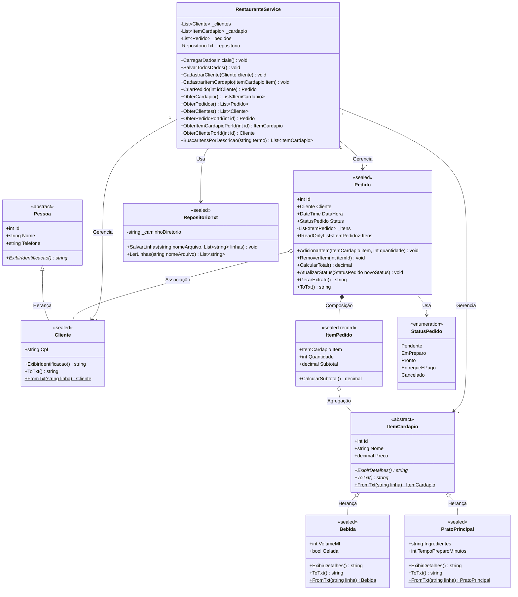

# Sistema de Gestão de Restaurante - .NET 10 & C# 14

Aplicação console desenvolvida seguindo rigorosamente o diagrama de classes da Etapa 1, estruturada com base nas boas práticas de desenvolvimento de software, Clean Code, os 4 pilares da Programação Orientada a Objetos (POO) e recursos nativos da plataforma .NET 10 com C# 14.

---

## Os 4 Pilares da POO Implementados

### 1. Abstração (`[ABSTRAÇÃO]`)

A abstração captura estritamente as características essenciais do domínio sem expor detalhes de implementação:

* **`Pessoa` (Classe Abstrata)**: Modela os atributos essenciais de qualquer indivíduo no sistema (`Id`, `Nome`, `Telefone`) e impõe o contrato abstrato `ExibirIdentificacao()`.
* **`ItemCardapio` (Classe Abstrata)**: Modela a base de qualquer produto vendável (`Id`, `Nome`, `Preco`) e estabelece os contratos abstratos `ExibirDetalhes()` e `ToTxt()`.

### 2. Herança (`[HERANÇA]`)

A herança estabelece relações semânticas do tipo "é-um", promovendo reutilização e extensibilidade:

* **`Cliente` herda de `Pessoa`**: Reutiliza dados de identificação e estende com o documento fiscal (`Cpf`). Definida como `sealed` para evitar extensões indesejadas.
* **`Bebida` herda de `ItemCardapio`**: Reutiliza dados de cardápio e especializa com `VolumeMl` e indicador booleano `Gelada`. Definida como `sealed`.
* **`PratoPrincipal` herda de `ItemCardapio`**: Reutiliza dados de cardápio e especializa com `Ingredientes` e `TempoPreparoMinutos`. Definida como `sealed`.

### 3. Polimorfismo (`[POLIMORFISMO]`)

O polimorfismo permite que objetos derivados respondam à mesma chamada com comportamentos especializados:

* **`ExibirIdentificacao()`**: Sobrescrito em `Cliente` para exibir identificador com CPF.
* **`ExibirDetalhes()`**: Sobrescrito em `Bebida` (exibindo volume e temperatura) e em `PratoPrincipal` (exibindo ingredientes e tempo de preparo).
* **Coleções Genéricas**: O serviço manipula listas polimórficas `List<ItemCardapio>`, iterando e exibindo detalhes via despacho dinâmico em tempo de execução.
* **Serialização (`ToTxt`)**: Cada subtipo formata sua própria linha com delimitadores para persistência em disco.

### 4. Encapsulamento (`[ENCAPSULAMENTO]`)

O encapsulamento protege o estado interno dos objetos através de modificadores de acesso e métodos com regras de negócio:

* **`Pedido`**: A coleção interna `_itens` é estritamente privada (`private readonly List<ItemPedido>`). O acesso externo ocorre somente leitura via `IReadOnlyList<ItemPedido> Itens => _itens.AsReadOnly()`. Adições e remoções passam por `AdicionarItem` e `RemoverItem`, bloqueando modificações em pedidos cancelados ou já entregues/pagos.
* **`ItemCardapio`**: O assessor `set` da propriedade `Preco` valida valores negativos através de um campo privado de apoio (`_preco`).
* **`ItemPedido`**: Implementado como `sealed record` com propriedades `init-only`, garantindo imutabilidade por valor e cálculo dinâmico do subtotal.
* **`RepositorioTxt`**: Encapsula caminhos de disco e operações nativas de I/O (`System.IO`).
* **`RestauranteService`**: Coleções privadas retornadas via cópias defensivas (`[.. _cardapio]`), impedindo alterações externas por referência.

---

## Diagrama de Classes Atualizado (Mermaid)



### Justificativas de Alterações em Relação ao Diagrama Inicial

* **`FromTxt(string linha)` em `Cliente`, `ItemCardapio`, `Bebida` e `PratoPrincipal`**: Adicionados como métodos estáticos para centralizar o parsing e reconstituição dos dados a partir de arquivos `.txt`.
* **`BuscarItensPorDescricao(string termo)` em `RestauranteService`**: Adicionado para viabilizar a consulta textual por nome de produto ou ingredientes requisitada no console.
* **`ObterPedidoPorId(int id)` e `ObterItemCardapioPorId(int id)` em `RestauranteService`**: Adicionados para permitir consultas diretas por ID sem violar o encapsulamento das coleções privadas.
* **`ObterClientes()` e `ObterClientePorId(int id)` em `RestauranteService`**: Adicionados para viabilizar a seleção interativa de clientes na abertura de pedidos.

---

## Tabela de Rastreabilidade e Observabilidade da POO

A tabela a seguir correlaciona a aplicação de cada pilar da Orientação a Objetos com a sua localização exata no código-fonte:

| Pilar da POO | Arquivo | Linhas | Elemento / Membro | Justificativa / Motivação Arquitetural |
| --- | --- | --- | --- | --- |
| **Abstração** | `Models/Pessoa.cs` | 4-9 | `public abstract class Pessoa` | Define o contrato conceitual comum de pessoas sem permitir instâncias incompletas no domínio. |
| **Abstração** | `Models/Pessoa.cs` | 40-45 | `ExibirIdentificacao()` | Obriga as subclasses a fornecerem sua própria apresentação formatada. |
| **Abstração** | `Models/ItemCardapio.cs` | 4-9 | `public abstract class ItemCardapio` | Isola as propriedades essenciais de produtos comercializáveis e padroniza o menu. |
| **Abstração** | `Models/ItemCardapio.cs` | 57-67 | `ExibirDetalhes()`, `ToTxt()` | Contratos abstratos para exibição rica e serialização desacopladas por produto. |
| **Herança** | `Models/Cliente.cs` | 4-9 | `class Cliente : Pessoa` | Reutiliza atributos cadastrais básicos de Pessoa e especializa com o CPF do cliente. |
| **Herança** | `Models/Bebida.cs` | 4-9 | `class Bebida : ItemCardapio` | Estende `ItemCardapio` adicionando volume em mililitros e controle de temperatura. |
| **Herança** | `Models/PratoPrincipal.cs` | 4-9 | `class PratoPrincipal : ItemCardapio` | Estende `ItemCardapio` adicionando lista de ingredientes e tempo estimado de cozinha. |
| **Polimorfismo** | `Models/Cliente.cs` | 30-35 | `override ExibirIdentificacao()` | Sobrescreve a identificação padrão para incluir prefixo e CPF do cliente. |
| **Polimorfismo** | `Models/Bebida.cs` | 32-38 | `override ExibirDetalhes()` | Despacho dinâmico exibindo volume (ml) e indicação de bebida gelada. |
| **Polimorfismo** | `Models/Bebida.cs` | 43-48 | `override ToTxt()` | Formata campos específicos de bebida para persistência delimitada. |
| **Polimorfismo** | `Models/PratoPrincipal.cs` | 34-39 | `override ExibirDetalhes()` | Despacho dinâmico exibindo receita, ingredientes e tempo de preparo. |
| **Polimorfismo** | `Models/PratoPrincipal.cs` | 44-49 | `override ToTxt()` | Formata campos específicos de prato principal para persistência delimitada. |
| **Polimorfismo** | `Models/ItemCardapio.cs` | 70-82 | `FromTxt(string linha)` | Factory polimórfica que instancia `Bebida` ou `PratoPrincipal` via pattern matching. |
| **Polimorfismo** | `Models/ItemPedido.cs` | 39-43 | `CalcularSubtotal()` | Acessa `Item.Preco` polimorficamente sem checagens condicionais de tipo. |
| **Polimorfismo** | `Models/Pedido.cs` | 99-104 | `CalcularTotal()` | Consolida valores iterando sobre a coleção genérica de itens polimórficos. |
| **Polimorfismo** | `Services/RestauranteService.cs` | 52-60 | `CadastrarItemCardapio(...)` | Recebe a base abstrata e armazena qualquer subtipo na mesma coleção `_cardapio`. |
| **Polimorfismo** | `Services/RestauranteService.cs` | 137-148 | `SalvarTodosDados()` | Invoca `i.ToTxt()` polimorficamente gravando registros específicos em lote. |
| **Encapsulamento** | `Models/Pessoa.cs` | 10-28 | `init`, construtor protegido | Valida integridade (nomes/telefones não-vazios e ID positivo) no momento da criação. |
| **Encapsulamento** | `Models/Cliente.cs` | 22-27 | Validação de CPF | Impede cadastro de clientes com documento em branco. |
| **Encapsulamento** | `Models/ItemCardapio.cs` | 15-28 | `_preco`, assessor `set` | Protege contra atribuição de preços negativos via campo privado de apoio. |
| **Encapsulamento** | `Models/ItemPedido.cs` | 4-29 | `sealed record` e construtor | Imutabilidade por valor e validação de quantidade estritamente positiva. |
| **Encapsulamento** | `Models/Pedido.cs` | 19-32 | `_itens` e `IReadOnlyList` | Lista interna privada exposta como somente leitura para evitar mutações diretas. |
| **Encapsulamento** | `Models/Pedido.cs` | 55-78 | `AdicionarItem(...)` | Centraliza regras de negócio e bloqueia alterações em comandas fechadas/canceladas. |
| **Encapsulamento** | `Models/Pedido.cs` | 83-94 | `RemoverItem(...)` | Assegura que itens só sejam excluídos se o pedido ainda estiver em aberto. |
| **Encapsulamento** | `Models/Pedido.cs` | 109-120 | `AtualizarStatus(...)` | Máquina de estados que impede reabertura de pedidos pagos ou alteração de cancelados. |
| **Encapsulamento** | `Repositories/RepositorioTxt.cs` | 11-26 | `_caminhoDiretorio` | Oculta operações físicas de diretório e chamadas a `System.IO` das camadas superiores. |
| **Encapsulamento** | `Services/RestauranteService.cs` | 15-21, 83-97 | Listas privadas e cópias | Protege as coleções em memória retornando cópias defensivas (`[.. _cardapio]`). |

---

## Declaração de Uso de Ferramentas de IA

Em conformidade com os critérios éticos e diretrizes de entrega do projeto acadêmico, declara-se a utilização de ferramenta de Inteligência Artificial generativa:

* **Ferramenta**: Gemini (Google AI).
* **Trechos desenvolvidos/revisados com auxílio da ferramenta**:
  * Repositório de persistência nativa (`Repositories/RepositorioTxt.cs`).
  * Serviço de regras e consultas (`Services/RestauranteService.cs`).
  * Interface interativa de console com ciclo limpo (`Program.cs`).
  * Documentação em `README.md`.
  * Documentação em código marcando os demais locais do projeto com as tags de qual pilar do POO foi utilizado (`Models/Pessoa.cs`, `Models/Cliente.cs`, `Models/ItemCardapio.cs`, `Models/Bebida.cs`, `Models/PratoPrincipal.cs`, `Models/ItemPedido.cs` e `Models/Pedido.cs`).

---

## Estrutura de Arquivos do Projeto

```text
ComandaFacil/
│
├── ComandaFacil.csproj           # Arquivo de projeto .NET 10 (C# 15)
├── Program.cs                       # Interface de console com 13 opções e tela limpa
├── README.md                        # Documentação técnica e rastreabilidade
│
├── Enums/
│   └── StatusPedido.cs              # Enumeração de status do ciclo de vida
│
├── Models/
│   ├── Pessoa.cs                    # [ABSTRAÇÃO] Classe base abstrata
│   ├── Cliente.cs                   # [HERANÇA / POLIMORFISMO] Subclasse selada
│   ├── ItemCardapio.cs              # [ABSTRAÇÃO / ENCAPSULAMENTO] Base de produtos
│   ├── Bebida.cs                    # [HERANÇA / POLIMORFISMO] Especialização de bebida
│   ├── PratoPrincipal.cs            # [HERANÇA / POLIMORFISMO] Especialização de prato
│   ├── ItemPedido.cs                # [ENCAPSULAMENTO / POLIMORFISMO] Record de linha de pedido
│   └── Pedido.cs                    # [ENCAPSULAMENTO / POLIMORFISMO] Raiz de agregação
│
├── Repositories/
│   └── RepositorioTxt.cs            # [ENCAPSULAMENTO] Persistência nativa em disco (.txt)
│
├── Services/
│   └── RestauranteService.cs        # [ENCAPSULAMENTO / POLIMORFISMO] Orquestrador de domínio
│
└── dados_restaurante/               # Arquivos persistidos de exemplo (.txt)
    ├── clientes.txt
    ├── cardapio.txt
    └── pedidos.txt
```

---

## Arquivos de Persistência de Exemplo (.txt)

### `dados_restaurante/clientes.txt`

```text
CLIENTE;1;Ana Souza;(31) 98765-4321;123.456.789-00
CLIENTE;2;Carlos Oliveira;(37) 99123-4567;987.654.321-99
CLIENTE;3;Beatriz Ferreira;(11) 97654-3210;456.789.123-55
```

### `dados_restaurante/cardapio.txt`

```text
BEBIDA;101;Suco Natural de Laranja;12.50;500;True
BEBIDA;102;Refrigerante Guaraná;8.00;350;True
BEBIDA;103;Café Espresso Gourmet;6.50;120;False
PRATO_PRINCIPAL;201;Feijoada Tradicional Completa;48.90;Feijão preto, carnes nobres, arroz, couve refogada, farofa e laranja;25
PRATO_PRINCIPAL;202;Filé de Frango Grelhado com Legumes;34.00;Peito de frango selecionado, brócolis, cenoura no vapor e arroz integral;18
PRATO_PRINCIPAL;203;Lasanha Artesanal à Bolonhesa;42.00;Massa fresca, molho de carne especial, queijo muçarela e parmesão gratinado;30
```

### `dados_restaurante/pedidos.txt`

```text
PEDIDO;1;1;2026-11-06T14:30:00.0000000;EmPreparo;201:1|101:2
PEDIDO;2;2;2026-11-06T14:45:00.0000000;Pendente;203:1|102:1
```

---

## Como Executar

Você pode rodar a aplicação baixando o executável pronto (sem necessidade de instalar nada) ou compilando o código-fonte manualmente.

### Opção 1: Executável Pronto (Recomendado)

Não requer a instalação do .NET no computador:

1. Acesse a aba de Releases (../../releases) deste repositório.
2. Na versão mais recente, baixe o arquivo executável (ComandaFacil.exe ou o pacote .zip).
3. Dê dois cliques no arquivo ou execute-o via terminal:
   .\ComandaFacil.exe

Nota: Caso o Windows SmartScreen exiba um aviso de segurança por se tratar de um executável não assinado, clique em "Mais informações" e depois em "Executar assim mesmo".

---

### Opção 2: Compilação Manual via Código-Fonte

#### Pré-requisitos
- SDK do .NET 10 instalado na máquina.

#### Execução via Terminal

```bash
# Acessar a pasta do projeto
cd ComandaFacil

# Compilar e rodar a aplicação
dotnet run
```
